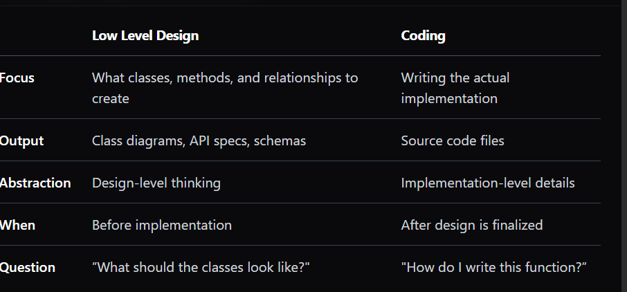

The low level design is  the process of defining the individual components of the software systems work internally  the class , methods , data structure , algorithms , and iinteractions that turn architecture into working code  

LLD is not coding it happens before  we write code 

skipping LLD and coding like building house with out blue print

The seven important componnets and principles of lowel design is ___>1. class and Objects
2. Data structure
3. Algorithm
4. Design patterns
5. Interface and abstraction(Interfaces define contracts—what a class promises to do without specifying how. They’re the backbone of extensible design.)
6. Dependency injection
7. SOLID principles
 Relationships Between Classes(connection of classes is more important classes themselves) thte more important is the way how clsasses connect to each other 